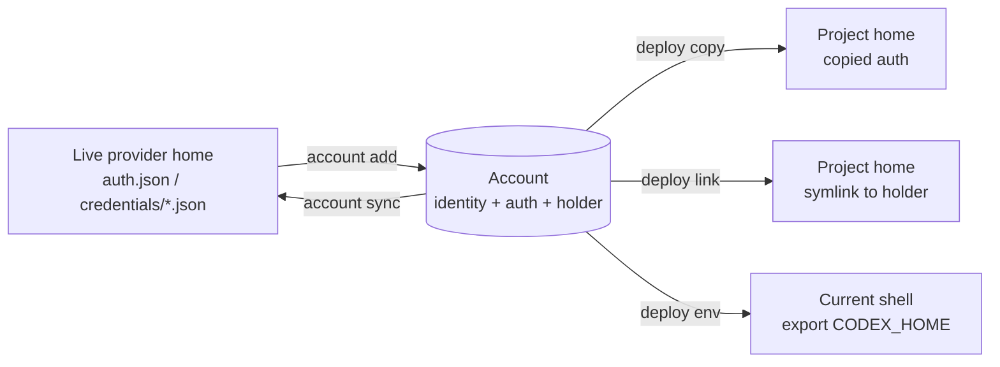

# lairen 来人

**Bring the right CLI-agent identity to the right place.**

lairen manages CLI-agent accounts. An account is one credential identity
accepted by a provider CLI. It can keep a credential copy inside lairen, point
at one live holder home, or both. Projects can use the account by copying the
stored auth, linking to the holder, or activating the holder in the shell.

[Install lairen](getting-started/installation.md){ .md-button .md-button--primary }
[Quick start](getting-started/quickstart.md){ .md-button }

!!! note "Project status"

    lairen is at `2.0.0`. The Codex and Kimi Code adapters are covered by
    live-credential tests. The `claude`, `commandcode`, `cursor`, and
    `opencode` adapters are implemented against their upstream storage layouts
    but remain experimental until live-credential tests exist.

## Why lairen

<div class="grid cards" markdown>

-   :material-account-key: **Account is first class**

    ---

    Identity, stored auth, holder home, aliases, usage, and deployments all
    live under one account. No separate holder registry to reconcile.

-   :material-folder-lock: **Keep credentials out of repositories**

    ---

    A project can own a `.codex` or `.kimi-code` path without that path
    becoming the only copy of the login.

-   :material-link-variant: **Three deploy modes**

    ---

    Copy stored auth, symlink a project home to the holder, or export the
    holder in the current shell.

-   :material-alert-outline: **Staleness is visible, not blocking**

    ---

    A copy deploy marks the holder possibly stale. `link` and `env` still work;
    `status --strict` explains the reason and the repair command.

-   :material-fingerprint: **Preserve real identities**

    ---

    Kimi identities include the device session, so two logins of the same
    account stay separately addressable as `user_id--device_id`.

-   :material-clock-outline: **Inspect expiry locally**

    ---

    `lairen account usage` reports token expiry and per-provider metadata,
    with JSON output for scripts.

</div>

## Model

```text
account = provider + identity
  codex  -> email / account_key
  kimi   -> user_id--device_id

account
  ├── auth    optional credential copy inside lairen
  ├── holder  optional live, pre-logged-in home (at most one)
  └── deployments
        copy  stored auth -> project home
        link  project home -> holder home
        env   current shell -> holder home
```

An account can have auth only, holder only, both, or neither.

## How it works



`account add` reads a live provider home, derives the account identity, stores
auth by default, and records the home as the holder. `deploy copy` writes the
stored credential into a project. `deploy link` creates a symlink. `deploy env`
prints an export.

A copy deploy to a different home marks the holder `possibly-stale`, because
the copied session may refresh and rotate tokens. lairen never blocks the
holder: `link`, `env`, and `status` continue to work, with warnings. `status
--strict` fails and prints the reason plus `lairen account sync`.

## Install

```bash
uv tool install lairen
lairen --version
```

See [Installation](getting-started/installation.md) for `uvx`, project
dependencies, source checkouts, and Pixi.

## First commands

```bash
lairen account scan ~/code --depth 2
lairen account add --provider codex --home ~/codex-holders/codex-aj --alias aj
lairen account list
lairen deploy copy aj --project ~/code/project-a
lairen deploy link aj --project ~/code/project-b
eval "$(lairen deploy env aj)"
lairen account usage
```

Continue with the [Quick start](getting-started/quickstart.md).

## Documentation map

- [Installation](getting-started/installation.md): install and verify lairen.
- [Quick start](getting-started/quickstart.md): add an account, deploy all three ways, and inspect it.
- [Identities and refs](concepts/identities.md): how accounts are keyed and resolved.
- [Storage and paths](concepts/storage.md): registry, credentials, snapshots, and deployment log.
- [Scan for accounts](guides/scanning.md): discover credential homes under a directory.
- [Deploy an account](guides/deploying.md): copy, link, env, and holder staleness.
- [Track usage and expiry](guides/usage.md): stored auth and holder metadata.
- [CLI reference](reference/cli.md): every command, option, exit code, and `lairen manual`.
- [Provider reference](reference/providers.md): supported agents and their storage layouts.

## Security at a glance

Credential files are stored in plaintext with `0600` permissions, matching the
native clients. lairen never prints tokens, and copy deployment snapshots
protect files it overwrites. `link` and `env` intentionally share one live
holder across projects, so concurrent agents still share that OAuth session.
Read the [security model](concepts/security.md) before sharing a holder.

## License

MIT
