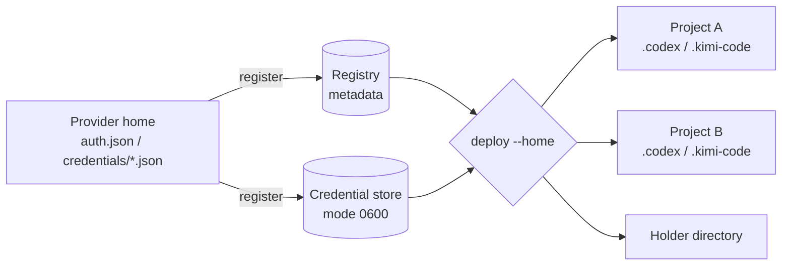

# lairen 来人

**Bring the right CLI-agent identity to the right place.**

lairen is a credential registry and deployer for CLI coding agents. It stores a
provider login once and writes it into any provider home on demand:
project-local directories, holder directories, or throwaway worktrees.

[Install lairen](getting-started/installation.md){ .md-button .md-button--primary }
[Quick start](getting-started/quickstart.md){ .md-button }

!!! note "Project status"

    lairen is at `1.x`. The Codex and Kimi Code adapters are covered by
    live-credential tests. The `claude`, `commandcode`, `cursor`, and
    `opencode` adapters are implemented against their upstream storage layouts
    but remain experimental until live-credential tests exist.

## Why lairen

<div class="grid cards" markdown>

-   :material-folder-lock: **Keep credentials out of repositories**

    ---

    A project can own a `.codex` or `.kimi-code` directory without that
    directory becoming the only copy of the login.

-   :material-swap-horizontal: **Deploy into any home**

    ---

    Write a saved login into a holder directory, a project, or a temporary
    worktree. The target is always an explicit `--home` argument.

-   :material-fingerprint: **Preserve real identities**

    ---

    Kimi identities include the device session, so two logins of the same
    account stay separately addressable as `user_id--device_id`.

-   :material-tag: **Stable aliases**

    ---

    Give long Kimi session refs a short handle that works anywhere a ref does.

-   :material-clock-outline: **Inspect expiry locally**

    ---

    `lairen usage` reports token expiry and per-provider metadata, with JSON
    output for scripts.

-   :material-console: **CLI arguments first**

    ---

    Every input is a command-line argument. Common provider environment
    variables such as `CODEX_HOME` are respected only as fallbacks.

</div>

## How it works



`register` reads a live provider home and saves two things: account metadata in
the registry and the credential blob in a separate store. `deploy` resolves a
saved account and atomically writes its credential into the target home,
snapshotting any file it replaces.

## Install

```bash
uv tool install lairen
lairen --version
```

See [Installation](getting-started/installation.md) for `uvx`, project
dependencies, source checkouts, and Pixi.

## First commands

```bash
lairen scan ~/code --depth 2
lairen register codex --home ~/code/project-a/.codex
lairen list
lairen deploy codex/alice@example.com --home ~/code/project-b/.codex
lairen usage
```

Continue with the [Quick start](getting-started/quickstart.md).

## Documentation map

- [Installation](getting-started/installation.md): install and verify lairen.
- [Quick start](getting-started/quickstart.md): register, deploy, and inspect a login.
- [Identities and refs](concepts/identities.md): how accounts are keyed and resolved.
- [Storage and paths](concepts/storage.md): where registry, credentials, snapshots, and the deployment log live.
- [Scan for accounts](guides/scanning.md): discover credential homes under a directory.
- [Deploy credentials](guides/deploying.md): target resolution, snapshots, and merge behavior.
- [Check a project](reference/cli.md#status): accounts in use, drift, and other project leases.
- [CLI reference](reference/cli.md): every command, option, exit code, and the agent-oriented `lairen manual`.
- [Provider reference](reference/providers.md): supported agents and their storage layouts.

## Security at a glance

Credential files are stored in plaintext with `0600` permissions, matching the
native clients. lairen never prints tokens, and deployment snapshots protect
files it overwrites. OAuth refresh tokens cannot be safely used by two active
homes at once; read the [security model](concepts/security.md) before swapping
accounts between projects that may run concurrently.

## License

MIT
